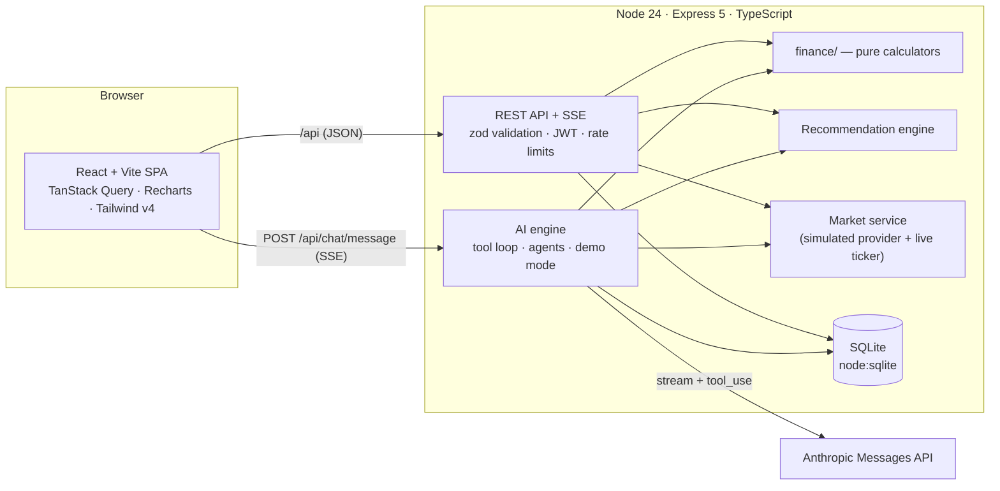

# Finvara

**Personal finance, wealth planning and AI advisory in one workspace.**
Budgeting · goal & retirement planning · will writing · mutual fund and stock research · three Claude‑powered advisors with fifteen tools · admin console.

> Portfolio project. All market data is **simulated** (fictional funds and companies) and the will/tax/insurance output is educational, not professional advice.

---

## Highlights

| Area | What it does |
| --- | --- |
| **Budgeting** | Categories with monthly plans, transactions with search, **CSV import/export**, planned‑vs‑actual, 50/30/20 check, insights, expense‑trim suggestions, savings goals, emergency‑fund plan, **auto‑detected recurring bills & subscriptions** with a due‑date timeline, and **reports** (category trends, savings rate, top merchants). |
| **Financial planner** | Milestones with required monthly saving, projections, suggested mix and matching funds; **retirement planner with a 1,000‑path Monte Carlo** — success probability, fan chart, sliders, and “what would improve your odds?” levers; starts from your *actual* saving rate. |
| **Calculators** | Public (no sign‑up) SIP with step‑up, lump‑sum and debt‑payoff calculators. |
| **Will writing** | Six‑step guided wizard with autosaved drafts, 100 %‑share validation, completeness checks, generated will (HTML + Markdown), print/PDF flow. HTML output is escaped. |
| **Mutual funds** | Curated collections (beginner‑friendly, low cost, income…), screener, per‑fund detail, side‑by‑side compare (rebased performance chart), portfolio builder with look‑through allocation, watchlist, risk‑scored recommendations with reasons. |
| **Stocks** | Live‑ticking (simulated) screener with one‑click ideas, movers, sector heat‑map, detail pages, watchlist, recommendations. |
| **Dashboard & UX** | Net worth over time, getting‑started checklist, upcoming bills, **⌘K command palette**, quick‑add menu, mobile bottom tabs, glossary tooltips for jargon, skeleton loaders, honest empty states. See [docs/UX-RESEARCH.md](docs/UX-RESEARCH.md). |
| **AI advisors** | 3 agents × 5 tools = **15 tools**. Streaming chat, visible tool calls, conversation history, offline demo mode when no API key is set. |
| **Alerts** | Bell with alerts and reminders derived from your data: over‑budget categories, budget at 90 %/100 %, goals nearing deadline, milestones off‑track, big watchlist moves, portfolio concentration, missing will/risk profile. Dismissals persist. |
| **Admin** | KPIs, user management, fund/stock CMS, recommendation weight tuning with live preview, chatbot monitoring (tool usage, latency, errors, full transcripts), runtime settings (kill switch, model, limits, announcement banner). |

## Architecture



**Key design decisions**

* **One calculation layer, two consumers.** Every number the user sees — on a page or from the chatbot — comes from the same pure functions in `server/src/finance/`. The AI tools are thin, validated wrappers around them, so the model explains results instead of doing arithmetic.
* **Zero native dependencies.** SQLite via Node's built‑in `node:sqlite`; auth with `bcryptjs`. `npm install` just works.
* **Provider seam for market data.** `server/src/market.ts` exposes a `MarketDataProvider` interface; the shipped implementation is a seeded random walk plus an in‑memory tick overlay. Swap in a real vendor without touching routes or the UI.
* **Admin‑tunable recommendations.** Fund/stock scores are a weighted blend (risk fit, returns, cost/valuation, quality). Weights, minimum match and list size live in the `settings` table and are editable in the admin UI.

## Quick start

Requires **Node ≥ 24** (uses the built‑in SQLite module).

```bash
npm install
cp .env.example .env        # optional: add ANTHROPIC_API_KEY for live Claude replies
npm run dev                 # API on :4000, web on :5173
```

Open <http://localhost:5173>. The database is created and seeded on first start.

| Account | Email | Password |
| --- | --- | --- |
| Demo user (6 months of data) | `demo@finvara.app` | `Demo1234!` |
| Admin | `admin@finvara.app` | `Admin123!` |

> Change or delete these before any real deployment (`npm run seed` resets the database to this demo state).

### Scripts

| Command | Purpose |
| --- | --- |
| `npm run dev` | API (tsx watch) + Vite dev server with `/api` proxy |
| `npm run build` | Typecheck + production build of the web app |
| `npm start` | Production server — serves the API **and** `web/dist` (SPA fallback) |
| `npm test` | 70 tests: finance maths, full API integration, live‑Claude path against a fake Anthropic server |
| `npm run typecheck` | `tsc` for both packages |
| `npm run seed` | Reset database to the demo dataset |

### Production

```bash
npm run build
NODE_ENV=production JWT_SECRET="$(openssl rand -hex 32)" ANTHROPIC_API_KEY=sk-ant-... npm start
```

The server refuses to boot in production without `JWT_SECRET`. Put it behind HTTPS (the app sets Helmet headers incl. a strict CSP; HSTS applies once served over TLS). SQLite is a single file — mount it on a persistent volume.

## The AI advisors

Three specialist agents, each with its own system prompt and exactly five tools:

| Agent | Tools |
| --- | --- |
| **Personal Finance** | `analyze_budget` · `recommend_savings` · `plan_goal` · `assess_risk` · `optimize_expenses` |
| **Investment Advisory** | `recommend_stocks` · `match_mutual_funds` · `analyze_portfolio` · `market_insight` · `analyze_sectors` |
| **Wealth & Retirement** | `plan_retirement` · `optimize_taxes` · `project_wealth` · `assess_insurance` · `estate_planning` |

**How a reply is produced** (`server/src/ai/engine.ts`)

1. Build a system prompt: agent role + guardrails + a `<user_context>` block (profile, risk score, this month's budget, topics the user asks about most).
2. Replay the last 20 messages as plain text (context management), then stream from the Messages API with the agent's tools (`input_schema` generated from the same zod schemas that validate inputs).
3. On `tool_use`: validate input → run the tool against the user's data → return the JSON as `tool_result` (errors are returned as `is_error`, never thrown) → loop (max 6 rounds). Several tool calls per turn are supported.
4. Text deltas, tool start/finish events and a final `done` event stream to the browser over SSE; the message, token usage, latency and every tool call (input/output/duration) are persisted for admin monitoring.
5. Handles `refusal`, `max_tokens` and typed API errors with friendly in‑chat messages.

**Preference learning:** each successful tool call increments a per‑user topic counter that is fed back into the system prompt; the risk‑assessment tool writes the user's risk profile, which immediately re‑ranks recommendations.

**Demo mode:** with no `ANTHROPIC_API_KEY`, the same tools run behind a keyword router and render their results as markdown, so the whole product (and every tool) is demonstrable offline. The UI labels this clearly.

**Models:** defaults to `claude-opus-5-5` (override with `ANTHROPIC_MODEL` or live in Admin → Settings). Adaptive thinking is on by default for that model; reasoning depth is controlled by `ANTHROPIC_EFFORT`. Tool choice is left on `auto` — forced `tool_choice` is rejected by the newest models, so tools are steered from the prompt instead.

## Recommendation engine

`score = 100 × Σ wᵢ·componentᵢ` (weights normalised), components in 0‥1:

* **Risk fit** — over‑risk is penalised 2× more than under‑risk (funds use the fund's 1–5 rating, stocks derive 1–5 from beta).
* **Returns** — 3Y/1Y return (funds), 1Y momentum + EPS growth (stocks).
* **Cost / valuation** — expense ratio (funds), P/E (stocks).
* **Quality** — Sharpe (funds), dividends & size (stocks; income‑focused users weight dividends).

Plus adjustments for short horizons, income goals and admin‑featured picks. Every recommendation returns human‑readable reasons.

## Project layout

```
server/src
  index.ts              app factory, security middleware, SPA hosting
  db.ts                 node:sqlite schema + helpers + typed settings
  seed.ts               deterministic market data (GBM) + demo users
  market.ts             provider seam, live ticker, screening, sector stats
  recommend.ts          scoring engine        portfolio.ts   analysis & fund blending
  will.ts               zod schema, checks, document generator (md + escaped html)
  finance/              budget · planning · montecarlo · calculators · recurring · tax · insurance · risk · math  (pure, unit-tested)
  ai/                   agents · tools (15) · engine (live loop + demo mode)
  routes/               auth profile budget planner will market dashboard chat admin
server/test             finance.test · api.test · chat-live.test (fake Anthropic server)
web/src
  pages/                Landing, Auth, Onboarding, Dashboard, Budget, Planner, Will, Funds, Stocks, Chat, Profile, admin/*
  components/           ui kit, charts, invest widgets, layout
  lib/                  api client (+ SSE reader), auth context, formatters
```

## API surface (all under `/api`, JSON, bearer JWT)

`auth/*` · `profile/*` (risk questionnaire, onboarding) · `budget/*` (categories, transactions + CSV import/export, goals, summary, trend, recurring, report) · `planner/*` (milestones, preview, retirement + Monte Carlo, defaults, strategy) · `will/*` (draft, validate, generate, download) · `funds/*` · `stocks/*` · `watchlist` · `portfolio/*` · `dashboard` (+ `/networth`) · `notifications` · `calc/*` (public) · `chat/*` (agents, conversations, `message` SSE) · `admin/*` (overview, users, funds, stocks, recommendations, chat monitor, settings).

## Security notes

* Passwords hashed with bcrypt; JWTs re‑validated against the database on every request, so deactivating a user takes effect immediately.
* Every query is parameterised; every body/query is validated with zod; all per‑user rows are scoped by `user_id` (covered by cross‑user tests for transactions and conversations).
* Login/signup rate‑limited; global API rate limit; Helmet + CSP; CORS closed in production.
* Generated will HTML is escaped (tested against script injection); deleted/deactivated content is hidden from users.
* Known trade‑offs for a demo: JWT lives in `localStorage` (a production deployment would prefer an httpOnly cookie + CSRF protection), and the seeded demo credentials are public.

## Limitations & ideas

* Market data is simulated; wire a real provider into `market.ts`.
* Tax figures are illustrative US single‑filer numbers (`finance/constants.ts`); the will template is generic.
* Single‑currency (USD), single‑node SQLite.
* Next steps: bank/CSV transaction import, recurring transactions, email/push delivery for the in‑app alerts, multi‑currency, Postgres adapter, E2E browser tests.
